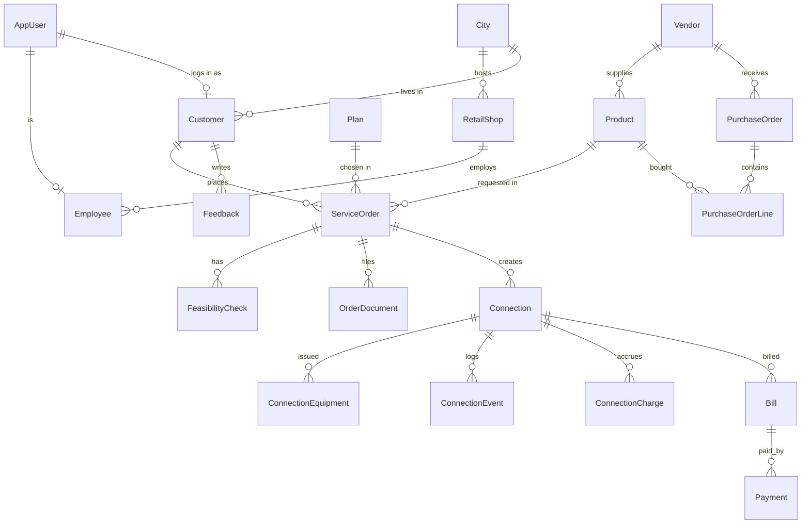

# Nexus Service Marketing System

ASP.NET Core MVC (.NET 8), C#, SQL Server 2022, Entity Framework Core 8, Bootstrap 5.
Telephone, dial-up and broadband: orders, feasibility, connections, postpaid billing, payments, stock and purchasing.

## Run it

1. Install the .NET 8 SDK and have a SQL Server 2022 instance (LocalDB or full).
2. Edit `ConnectionStrings:Default` in `appsettings.json` if your server is not `localhost` with Windows authentication.
3. `dotnet run`

On first start the app creates the database `NexusServiceMarketing` and loads the plans from the specification plus demo data.
To use EF migrations instead (recommended for a real deployment):

```
dotnet tool install --global dotnet-ef
dotnet ef migrations add Initial
dotnet ef database update
```

The app uses migrations automatically once any exist.

### Demo logins (password `Nexus@2026` for all)

| Username | Role | Notes |
|---|---|---|
| `admin` | Admin (manager) | employees, plans, rates, stock, vendors, shops, purchasing |
| `accounts1` | Accounts | bills, payments at the city office |
| `tech1`, `tech2` | Technical | feasibility, connections, equipment |
| `retail1` | Retail employee | Nexus Riverton Central |
| `retail2` | Retail employee | Nexus Halden Plaza |
| `mokonkwo`, `praghunathan` | Customer | portal |

Try the public lookup with any order id or account id shown in the app (no login needed).

## Who can do what

| | Admin | Accounts | Technical | Retail | Customer |
|---|---|---|---|---|---|
| Employees, shops, cities, vendors, plans, rates | yes | | | | |
| Equipment and stock | yes | | yes | | |
| Purchase orders (stock rises on receipt) | yes | | | | |
| Place an order | | | | yes (walk-in) | yes (own) |
| Feasibility check, create connections | | | yes | | |
| Suspend, reactivate, close, change plan, replace equipment | | | yes | | |
| Generate bills | | yes | | | |
| Take payments | | yes (city office) | | yes (shop) | |
| View orders, connections, bills, payments | all | all | orders, connections | own shop | own |
| Search by id, name, type, date, phone | all | all | all | own shop | own |
| Feedback | reads | | | | sends |

## Requirement traceability

| Requirement (specification) | Where |
|---|---|
| Order id: type letter + 10 digits | `IdFormat.OrderNo`, `SequenceService` |
| Account id: type letter + 3-digit city + 12-digit serial | `IdFormat.AccountId`, `City.Code` |
| Dial-up needs a Nexus landline; feasibility differs with or without one | `FeasibilityRules.Required`, `OrderService.PlaceAsync`, `ConnectionService.ProvisionAsync` |
| Feasibility by distance and server availability | `FeasibilityRules.Evaluate`, limits on the Rates page |
| Order status: placed, feasibility, feasible / not feasible, connected | `OrderStatus`, `_OrderWire` |
| Connection status: active, temporarily / permanently inactive | `ConnectionService.ChangeStatusAsync` |
| Plans, tariffs and per-minute call charges | `Plan`, `PlansController`, seeded from the specification |
| Security deposit per type, refundable | `SecurityDepositRate`, `Connection.SecurityDeposit`, refund on closure |
| Bulk discount on first rental and deposit | `DiscountScheme`, `Pricing.DiscountFor` |
| Service tax 12.24% on the whole bill | `Pricing.ComputeBill`, setting `Billing.TaxPercent` |
| Postpaid bills, previous dues carried forward | `BillingService.GenerateAsync` (`PreviousDue`, `CarriedForward`) |
| Replacement charge for equipment the customer damaged | `ConnectionCharge`, swept onto the next bill |
| Payments at shops and at the city office | `PaymentsController`, `Payment.RetailShopId` |
| Equipment, vendors, purchase lists, stock vs demand | `Product`, `Vendor`, `PurchaseOrder`, dashboards |
| Documents filed by year and area | `FileStore`: `App_Data/filing/{year}/{cityCode}/{orderNo}/` |
| Search by order id / account id (public) | `TrackController` |
| Advanced search: id, name, type, period, phone | `SearchController` |
| Customer portal, feedback | `Dashboard`, `FeedbackController` |
| Admin alone maintains employee data | `EmployeesController` |

## Decisions where the specification was silent or contradictory

- **Yearly STD plan price is blank in the specification.** Seeded as `$720` (following the falling monthly cost of 125, 70, 60). Change it on the Plans page.
- **Bulk tiers overlap at 15** (10-15 and 15-25). Seeded as 10-14 = 25%, 15-24 = 50%, 25-50 = 75%, 51+ = 100%. Editable on the Rates page; overlaps are rejected.
- **"Only retail employees place orders" vs "customers can place an order".** Both are supported: retail employees for walk-in customers, customers for themselves online.
- **STD half-yearly plan** says "valid for a month" in the specification; treated as 6 months.
- **Tax** is charged on the whole bill (rental, calls, replacement, deposit, less discount). Carried-forward dues are added afterwards, untaxed, because they were taxed when first billed.
- **Public lookup** shows status only (no names, phones or addresses). Searching by name, phone or date requires a login.
- Dial-up needs a landline: if the customer has none, one is created per dial-up connection with its own `T` account id.
- Feasibility limits default to 5 km (landline), 8 km (broadband), 10 km (dial-up). Adjustable.

## Security

PBKDF2 password hashing, lockout after 5 failed sign-ins, cookie authentication, role checks on every controller, anti-forgery tokens on every POST, record scoping (customers see only their own, retail only their shop), uploads limited to PDF/JPG/PNG up to 5 MB with signature check and stored outside `wwwroot`, strict Content-Security-Policy (no inline scripts or styles).

## Design

`Styles/site.scss` compiles Bootstrap 5 with custom tokens into `wwwroot/css/site.css` (`npm install && npm run build:css` after editing). Barlow and IBM Plex Mono are self-hosted. Order and account ids are rendered as cable-label tags (`Ui.Id`) and the order tracker is drawn as a wire (`_OrderWire`).

## Entity-relationship overview



## Test checklist

1. Sign in as `retail1`, New order, find "Tomasz" by phone, order a dial-up with an existing landline using his `T` account id; confirm the order is for one connection.
2. Place an order with 12 connections; confirm 25% discount shows on the form and on the order.
3. As `tech1`, record a landline check at 7 km: order becomes Not feasible. Re-check at 3 km: Feasible. Create the connection; confirm account ids are 16 characters and stock drops.
4. As `accounts1`, Bills to generate, preview then generate. Confirm the first bill includes deposit and discount, and tax is 12.24%.
5. Generate a second bill without paying the first; confirm the earlier balance is carried and the first bill shows "carried".
6. As `retail1`, take a part payment, then the rest; confirm status moves to Part paid, then Paid, and the receipt prints.
7. As `tech1`, suspend, reactivate, then close a connection; confirm a deposit refund amount appears for Accounts to record.
8. As a customer, confirm only your own orders, bills and payments are visible, and that another customer's detail URL returns 404.
9. Look up an order id and account id while signed out; confirm no personal details are shown.
10. As `admin`, retire a plan that has orders (it is retired, not deleted); add a city, shop and employee; raise a purchase order and receive it.

## Verification status

The code was type-checked with a real C# compiler (including every Razor view) against the ASP.NET shared framework, and the billing, discount, ID and feasibility rules were run against figures worked out from the specification (47 checks). It has **not** been run against a live SQL Server in the environment where it was written, so run the checklist above on first deployment.
